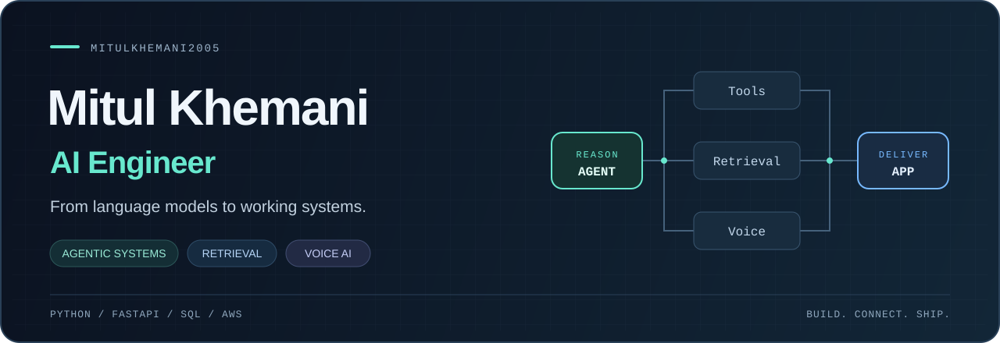

  

  <a href="https://mitul-khemani.vercel.app/">Portfolio</a> &nbsp; / &nbsp;
  <a href="https://www.linkedin.com/in/mitul-khemani/">LinkedIn</a> &nbsp; / &nbsp;
  <a href="mailto:khemanimitul@gmail.com">Email</a> &nbsp; / &nbsp;
  <a href="https://leetcode.com/u/khemanimitul/">LeetCode</a>

## Building AI that does useful work.

I'm **Mitul**, an AI engineer building applications that connect language models to tools, data, and real workflows. My work spans **agentic systems, RAG, and voice AI**, backed by Python APIs, SQL databases, and cloud deployment.

Previously an **Artificial Intelligence Intern at LearningBIX**, where I built an AI avatar learning platform, developed retrieval for NCERT text and images, and fine-tuned and deployed F5-TTS. I'm completing my **B.Tech in Electronics and Communication Engineering at LNMIIT (2023–2027)**.

**Open to AI engineering internships, graduate roles, and collaborations.** [Let's connect →](mailto:khemanimitul@gmail.com)

## Selected builds

### 01 &nbsp; [AI Growth Commerce · Agentic Store](https://github.com/mitulkhemani2005/AI-Growth-Commerce-Agentic-Store)

A commerce platform connecting a conversational shopping assistant with specialist agents for store operations. Built customer and dealer workflows around product discovery, cart actions, payments, order tracking, and refunds, with function calling and a SQL-backed API.

**Focus:** Tool use · Multi-agent coordination · Business workflows 
**Built with:** Python · FastAPI · SQL · Agentic AI

### 02 &nbsp; [Ek Manch · AI Event Operating System](https://github.com/mitulkhemani2005/EkManch)

Turns natural language event requirements into websites, mobile apps, and promotional content. Built a multi-agent website builder, an AI content studio, and a React Native / Expo app pipeline using GitHub Actions and EAS.

**Focus:** AI generation · Automated deployment · Full-stack orchestration 
**Built with:** FastAPI · Supabase · React Native · Expo · AWS

### 03 &nbsp; [AI World · Generational Life Simulation](https://github.com/mitulkhemani2005/AI-World-How-AI-Evolves-the-World)

An experimental playable world where two AI agents make survival and social decisions while their lives unfold across generations. A FastAPI simulation backend manages the world; an independent Three.js frontend displays it on a procedural globe.

**Focus:** Agent decision-making · Local inference · Simulation systems 
**Built with:** Python · FastAPI · SQLite · Ollama · Three.js

**More to explore:** [F5-TTS work](https://github.com/mitulkhemani2005/TTS_MODEL-F5_TTS) · [Customer support AI](https://github.com/mitulkhemani2005/Auto-Healing-Customer-Chat-Support) · [All repositories](https://github.com/mitulkhemani2005?tab=repositories)

## Engineering toolkit

| Area | Technologies & practice |
| :--- | :--- |
| **Generative & agentic AI** | LLMs, multi-agent systems, function calling, prompt engineering |
| **Retrieval & voice** | RAG, ChromaDB, text and image retrieval, F5-TTS fine-tuning |
| **APIs & data** | Python, FastAPI, Flask, REST APIs, SQL |
| **Deployment** | AWS, Docker, Git, CI/CD, GitHub Actions |
| **ML foundations** | PyTorch, TensorFlow, NumPy, Pandas |
| **Software foundations** | C++, data structures & algorithms, OOP, debugging, testing |

## Experience in practice

**Artificial Intelligence Intern · LearningBIX** 
April–July 2026 · Hybrid

- Built and deployed an **AI avatar learning platform**, integrating conversational AI, tutoring, and voice through REST APIs.
- Developed a **NCERT RAG system for text and images** to ground responses in relevant learning material.
- Debugged LLM-related bottlenecks in a **Smart Question Paper Generator** and improved its shipping pipeline.
- Fine-tuned and deployed **F5-TTS** for voice synthesis and maintained the production service.

Outside AI, I also built and deployed the [Hotel Shreegopal website](http://hotelshreegopal.online/) with a responsive interface and a booking flow.

## Milestones

- **AMD Slingshot · Regional finalist** — Led a three-member team presenting Ek Manch; top 100 teams nationally, with 5,000+ participants.
- **NIT Delhi Hackathon · Finalist** — Shortlisted among the top 65 teams from 400+ submissions.
- **LeetCode · Knight** — 490+ data structures and algorithms problems solved.

---

  <b>Let's build useful AI, end to end.</b> 
  <a href="mailto:khemanimitul@gmail.com">khemanimitul@gmail.com</a> &nbsp; · &nbsp;
  <a href="https://www.linkedin.com/in/mitul-khemani/">LinkedIn</a> &nbsp; · &nbsp;
  <a href="https://mitul-khemani.vercel.app/">Portfolio</a>

